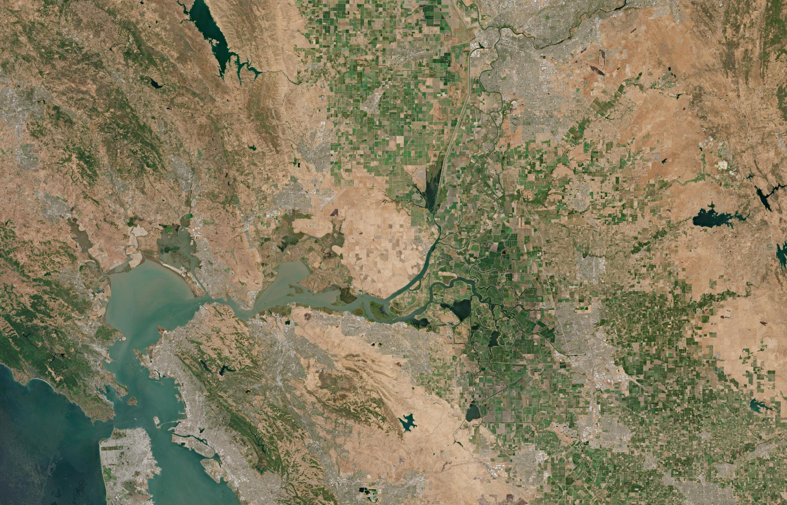
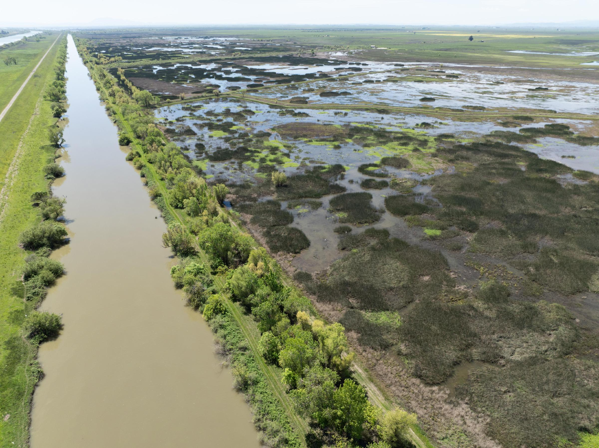
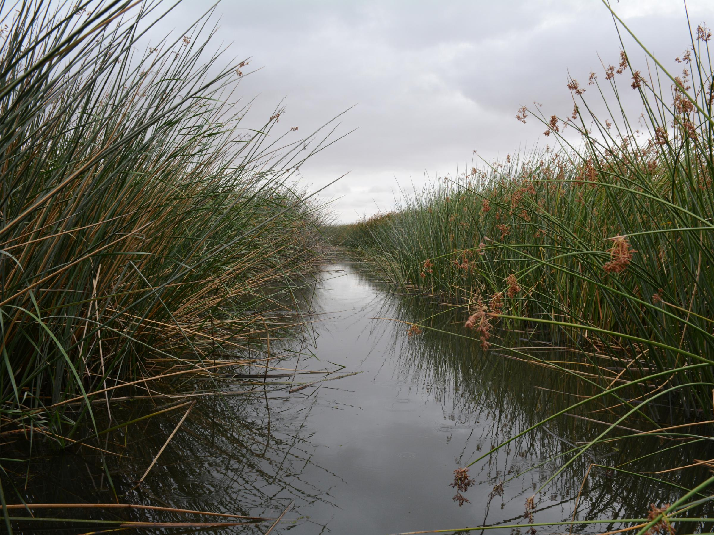
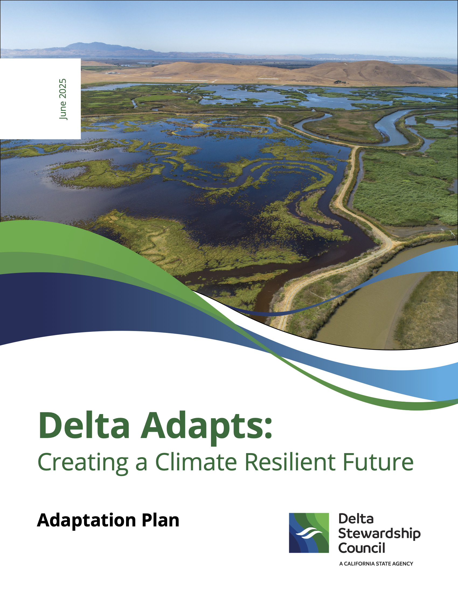
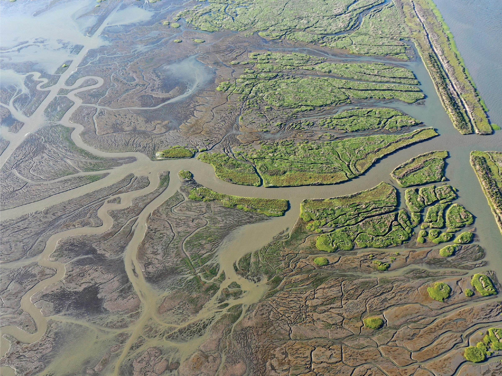
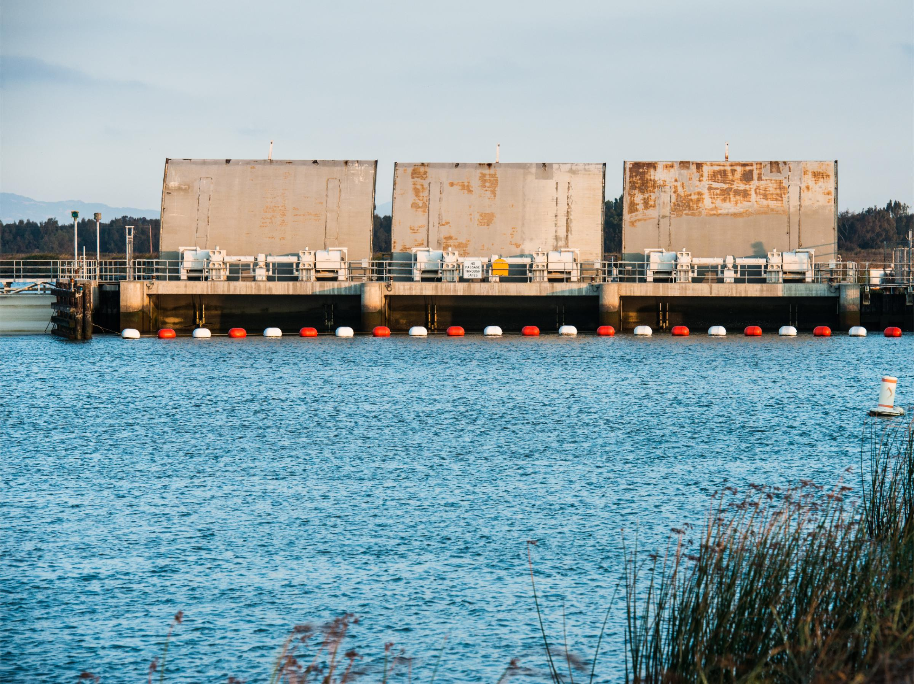
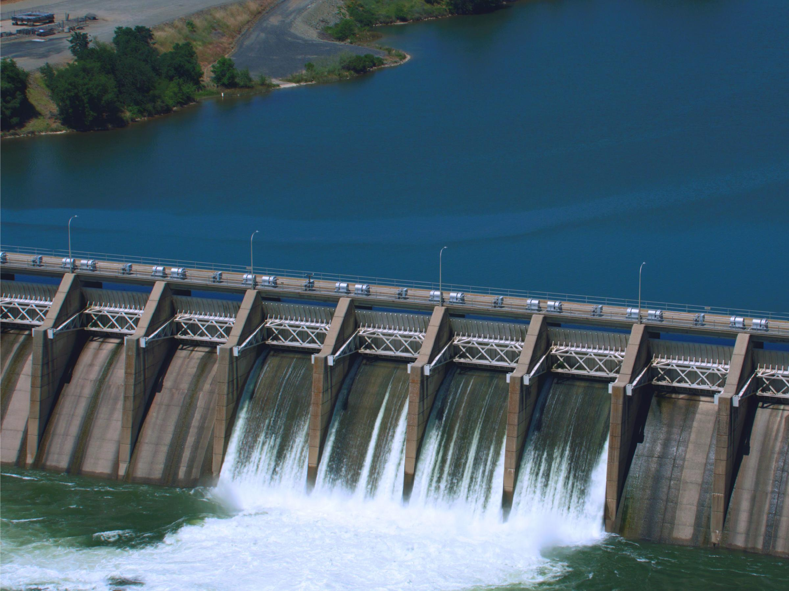
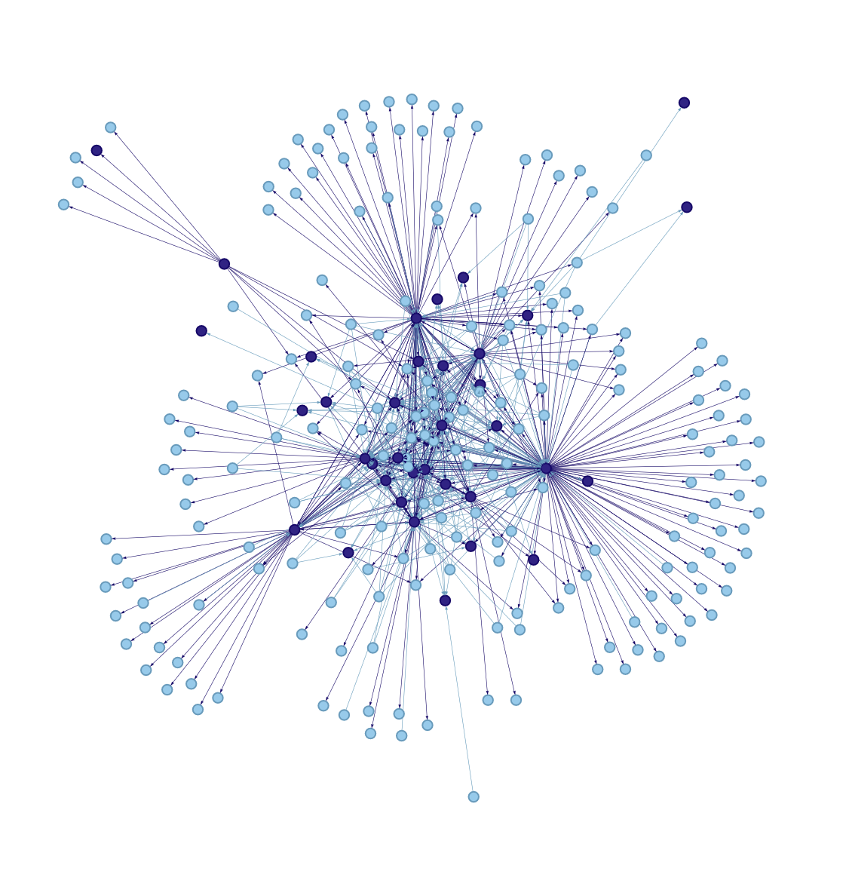

<!-- draft 5 -->

```{r}
#| include: false
here::i_am("index.qmd")
library(here)
source(here::here("init.R"))

# source("server_functions.R")
library(plotly)
library(DT)
library(visNetwork)
# library(shiny)
# library(bslib)
library(tidygraph)
library(kableExtra)
```

<!-- ~~~~~~~~~~~~~~~~~~~~~~~~~~~~~~~~~~~~~~~~~~~~~~~~~~~~~~~~~~~~~~~~~~~~~~~ -->
:::: {.cr-section layout="overlay-center"}

:::{focus-on="cr-sat_img"}

# Making *Just Transitions* a Reality

What does it take to make *Just Transitions Scenarios* a reality?<br><br>

To begin to answer this, we studied how each scenario would be *governed*.<br><br>



:::

:::{#cr-sat_img}

:::

::::
<!-- ~~~~~~~~~~~~~~~~~~~~~~~~~~~~~~~~~~~~~~~~~~~~~~~~~~~~~~~~~~~~~~~~~~~~~~~ -->
:::: {.cr-section layout="overlay-center"}

:::{focus-on="cr-restore"}
# Overview

In this presentation, we share our analysis of how to realize the Scenarios in the context of a changing climate, primarily by understanding the key actions and actors involved in their governance. <br><br>

We'll look at:

* **Data** and **Methods** for Examining Governance
* Key Implementation **Actions**
* Key **Actors**
* Next Steps
* Main **Takeaways**

:::

:::{#cr-restore}

:::

::::

<!-- ~~~~~~~~~~~~~~~~~~~~~~~~~~~~~~~~~~~~~~~~~~~~~~~~~~~~~~~~~~~~~~~~~~~~~~~ -->

:::: {.cr-section layout="overlay-center"}

::: {focus-on="cr-ecomac"}
# How We Examined Governance

We used existing research and data on "adaptive governance" in the Delta to map out important:

* **Implementation Actions** 
  * *Example: invest in levee maintenance.*
* **Actors** 
  * *Example: the California Dept. of Water Resources*


:::

:::{#cr-ecomac}

:::

::::
<!-- ~~~~~~~~~~~~~~~~~~~~~~~~~~~~~~~~~~~~~~~~~~~~~~~~~~~~~~~~~~~~~~~~~~~~~~~ -->
  
:::: {.cr-section layout="sidebar-left"}

::: {focus-on="cr-ap_cover"}

# Adaptation Plan

In 2025, the Delta Stewardship Council published the ["Adaptation Plan" (AP)](https://deltacouncil.ca.gov/pdf/delta-plan/2025-06-26-delta-adapts-adaptation-plan.pdf) to address the targets of adaptive governance in the California Delta.<br><br>

We used this plan as a starting place to look at the key actions and actors for each scenario. This data is the focus of this presentation.<br><br>

:::{.light-section}

:::

:::

::: {focus-on="cr-ap_cover"}
The Adaptation Plan has 4 "Strategic Areas" or themes to address Delta social-environmental management with the challenges of climate change. These include:

* Flood Risk Reduction (FL)
* Ecosystems (ECO)
* Agriculture (AG)
* Water Supply Reliability (WSR)

:::

::: {focus-on="cr-ap_cover"}
Under these four strategic areas, there are:

* 22 Adaptation Strategies with a total of:
  * 129 Implementation Actions
  * 10 lead and 67 partner organizations
  
:::

:::{#cr-ap_cover}

:::

::::

<!-- ~~~~~~~~~~~~~~~~~~~~~~~~~~~~~~~~~~~~~~~~~~~~~~~~~~~~~~~~~~~~~~~~~~~~~~~ -->
:::: {.cr-section layout="overlay-center"}

:::{focus-on="cr-inundate"}
# Methodology: Alignment

We examined how each action in the Adaptation Plan (AP) **align** with the goals and targets of each JT Scenario. We rated each action for each scenario along a rubric that essentially focuses on two framing questions: 

* **Is this a core action?** Does this governance action help realize the JT Scenario?
* **Is this a peripheral action?** Does this governance action potentially support the JT Scenario without direct engagement with scenario targets? 

Using this approach we determined a numeric score for each AP action under each Scenario.<br><br>


:::

:::{#cr-inundate}

:::

::::

<!-- ~~~~~~~~~~~~~~~~~~~~~~~~~~~~~~~~~~~~~~~~~~~~~~~~~~~~~~~~~~~~~~~~~~~~~~~ -->
  
:::: {.cr-section layout="sidebar-left"}

::: {focus-on="cr-actions_sankey"}  

# Scenario Actions

We found that `r nrow(jt_actions_only)` of the 129 AP actions were relevant to Just Transitions. <br><br>

:::{.light-section}

:::

:::

::: {#cr-actions_sankey}

```{r}

sankey_actions()
```

:::

::::

<!-- ~~~~~~~~~~~~~~~~~~~~~~~~~~~~~~~~~~~~~~~~~~~~~~~~~~~~~~~~~~~~~~~~~~~~~~~ -->
  
:::: {.cr-section layout="sidebar-right"}

::: {focus-on="cr-overall_actions"}
## Scenarios by Strategy Area

In this chart, each scenario is shown with its overall alignment with Adaptation Plan actions, grouped by the four strategy areas. The total score of each bar comprises a mix of both numbers of actions and strength of alignment. In other words, the larger the bar, the greater the number of weighted adaptive actions.<br><br>

:::{.light-section}

:::
:::

::: {focus-on="cr-overall_actions"}
### Takeaways

* Greater diversity of strategies to address salinity management in New Green Watershed, and also greater complexity in the task of governance.
* Fewest total number of actions for salinity management under a changing climate for the Tunnel.
* Calling on Reserves and Bolster & Fortify involve similar numbers of weighted actions for climate adaptation.

:::


::: {#cr-overall_actions} 

```{r}
overall_scenario_score_by_strategy_area <- dat$scenario_scores_by_action %>%
  dplyr::mutate(strategy_area = stringr::str_extract(strategy_id, 
                                                     stringr::regex("^[[:alpha:]]{2,3}"))) %>%
  dplyr::summarize(
    .by = strategy_area,
    dplyr::across(
      .cols = tidyselect::all_of(snm),
      .fns = ~sum(.x, na.rm = TRUE)
    )
  ) %>%
  tidyr::pivot_longer(
    cols = tidyselect::all_of(snm),
    names_to = "scenario",
    values_to = "score"
  ) %>%
  dplyr::mutate(area_color = purrr::map_chr(
      strategy_area,
      ~pal_area[which(names(pal_area) %in% .x)])) %>%
  dplyr::mutate(
    strategy_area = purrr::map_chr(
      strategy_area,
      ~area_key[names(area_key) == .x]
    )
  )

order_sce <- overall_scenario_score_by_strategy_area %>%
  dplyr::summarize(sumscore = sum(score), .by = "scenario") %>%
  dplyr::arrange(sumscore) %>%
  dplyr::mutate(scenario_fct = forcats::as_factor(scenario)) %>%
  dplyr::select(scenario, scenario_fct)

order_strat <- overall_scenario_score_by_strategy_area %>%
  dplyr::summarize(sumscore = sum(score), .by = "strategy_area") %>%
  dplyr::arrange(sumscore)%>%
  dplyr::mutate(order = row_number()) %>%
  dplyr::select(-sumscore)

overall_scenario_score_by_strategy_area <- overall_scenario_score_by_strategy_area %>%
  dplyr::left_join(y = order_sce, by = "scenario") %>%
  dplyr::left_join(y = order_strat, by = "strategy_area") %>%
  dplyr::select(-scenario) %>%
  dplyr::rename(scenario = scenario_fct) %>%
  dplyr::arrange(dplyr::desc(scenario), dplyr::desc(order))

viz_counts(
  data = overall_scenario_score_by_strategy_area,
  categorical = "strategy_area",
  x_ = "score",
  y_ = "scenario",
  color_ = "area_color"
)
```

:::

::::

<!-- ~~~~~~~~~~~~~~~~~~~~~~~~~~~~~~~~~~~~~~~~~~~~~~~~~~~~~~~~~~~~~~~~~~~~~~~ -->
  
:::: {.cr-section layout="sidebar-left"}

::: {focus-on="cr-ota"}
## Top Actions Overall

Across all scenarios, these are identified as the top actions.[^top_actions] More important actions may be identified as the larger cells on the right. <br><br>

:::{.callout-warning}
The purpose of this chart is to facilitate exploring the actions on your own time, *not* to demonstrate the relative importance of any strategy area.
:::

<br>

:::{.light-section}

:::

[^top_actions]: Top actions were defined as the top quartile of the sum scores of each action.
:::

:::{focus-on="cr-ota"}
### Takeaways

Notably, actions which affect how adaptive agricultural practices are regulated and supported are absent. This is because only New Green Watershed addresses changes in agricultural practices.

:::

:::{#cr-ota}

```{r}
ota <- overall_top_actions %>%
  dplyr::mutate(action_id = stringr::str_extract(
    action, "^[:alpha:]{2,3}\\-[:digit:]{1,2}\\-[:digit:]{1,2}")) %>%
  dplyr::mutate(strategy_id = stringr::str_extract(
    action, 
    "^[:alpha:]{2,3}\\-[:digit:]{1,2}")) %>%
  dplyr::select(action, action_id, strategy_id, total_score) %>%
  dplyr::rename(score = total_score)

viz_counts(
    data = scenario_scores_by_area(ota),
    categorical = "action_id",
    x_ = "score",
    y_ = "area",
    color_ = "area_color",
    show_legend = FALSE
)
```
:::

::::


<!-- ~~~~~~~~~~~~~~~~~~~~~~~~~~~~~~~~~~~~~~~~~~~~~~~~~~~~~~~~~~~~~~~~~~~~~~~ -->

:::: {.cr-section layout="sidebar-right"}
```{r}
sce <- snm[1]
scedat <- sscores[[sce]]
```

::: {focus-on="cr-em1"}
## Eco Machine

There are `r nrow(scedat)` actions aligned with `r sce`.<br><br>

:::{.callout-warning}
For the following slides, please pay attention to the changing scale for "score".
:::

<br>

:::{.light-section}

:::

:::

:::{#cr-em1}
```{r}
viz_counts(
    data = scedat,
    categorical = "action_id",
    x_ = "score",
    y_ = "area",
    color_ = "area_color",
    show_legend = FALSE
)
```

:::

::::

<!-- ~~~~~~~~~~~~~~~~~~~~~~~~~~~~~~~~~~~~~~~~~~~~~~~~~~~~~~~~~~~~~~~~~~~~~~~ -->
  
:::: {.cr-section layout="sidebar-right"}

::: {focus-on="cr-em2"}
### Unique Actions

What makes `r sce` unique and distinctive when compared to other scenarios, are flood risk reduction and ecosystem actions that help set the groundwork. In other words, actions that are directly performed in `r sce` are shared with other JT scenarios (like `r snm[2]`) and are not unique to this scenario.<br><br>

:::{.light-section}

:::


:::

:::{#cr-em2}
```{r}
viz_counts_adv(data = sunique[[sce]], show_legend = TRUE)
```

:::

::::

<!-- ~~~~~~~~~~~~~~~~~~~~~~~~~~~~~~~~~~~~~~~~~~~~~~~~~~~~~~~~~~~~~~~~~~~~~~~ -->

:::: {.cr-section layout="sidebar-left"}

```{r}
sce <- snm[2]
scedat <- sscores[[sce]]
```

::: {focus-on="cr-ngw1"}
## New Green Watershed

There are `r nrow(scedat)` actions aligned with `r sce`.<br><br>

:::{.light-section}

:::

:::

:::{#cr-ngw1}
```{r}
viz_counts(
    data = scedat,
    categorical = "action_id",
    x_ = "score",
    y_ = "area",
    color_ = "area_color",
    show_legend = FALSE
)
```

:::

::::

<!-- ~~~~~~~~~~~~~~~~~~~~~~~~~~~~~~~~~~~~~~~~~~~~~~~~~~~~~~~~~~~~~~~~~~~~~~~ -->
  
:::: {.cr-section layout="sidebar-left"}

::: {focus-on="cr-ngw2"}
### Unique Actions

Given that `r sce` has the most number of adaptive actions related to its performance, it is not surprising to find a number of core actions unique to this scenario. Some of these interventions are performed directly in the scenario, although most simply set a foundation.

:::

:::{#cr-ngw2}
```{r}
viz_counts_adv(data = sunique[[sce]], show_legend = TRUE)
```
:::

::::

<!-- ~~~~~~~~~~~~~~~~~~~~~~~~~~~~~~~~~~~~~~~~~~~~~~~~~~~~~~~~~~~~~~~~~~~~~~~ -->

:::: {.cr-section layout="sidebar-right"}
```{r}
sce <- snm[3]
scedat <- sscores[[sce]]
```

::: {focus-on="cr-t1"}
## Tunnel

There are `r nrow(scedat)` actions aligned with `r sce`. The `r sce` has the least potential number of actions and lowest alignment with the AP. No adaptive action directly targets the building blocks for this scenario. Finally, no core actions were identified as "unique" to `r sce`.

:::

:::{#cr-t1}
```{r}
viz_counts(
    data = scedat,
    categorical = "action_id",
    x_ = "score",
    y_ = "area",
    color_ = "area_color",
    show_legend = FALSE
)
```

:::

::::

:::: {.cr-section layout="sidebar-left"}
```{r}
sce <- snm[4]
scedat <- sscores[[sce]]
```

::: {focus-on="cr-bf1"}
## Bolster & Fortify

There are `r nrow(scedat)` actions aligned with `r sce`. Only three AP actions are directly performed under `r sce`, and these all directly relate to the infrastructure necessary to realize the scenario. 

:::

:::{#cr-bf1}
```{r}
viz_counts(
    data = scedat,
    categorical = "action_id",
    x_ = "score",
    y_ = "area",
    color_ = "area_color",
    show_legend = FALSE
)
```

:::

::::

<!-- ~~~~~~~~~~~~~~~~~~~~~~~~~~~~~~~~~~~~~~~~~~~~~~~~~~~~~~~~~~~~~~~~~~~~~~~ -->
  
:::: {.cr-section layout="sidebar-left"}

::: {focus-on="cr-bf2"}
### Unique Actions

Beyond the infrastructure actions already discussed above (which are unique), there are a number of distinct flood risk reduction actions that support, but do not by necessity correspond with core components of `r sce`.

:::

:::{#cr-bf2}
```{r}
viz_counts_adv(data = sunique[[sce]], show_legend = TRUE)
```
:::

::::

<!-- ~~~~~~~~~~~~~~~~~~~~~~~~~~~~~~~~~~~~~~~~~~~~~~~~~~~~~~~~~~~~~~~~~~~~~~~ -->

:::: {.cr-section layout="sidebar-right"}
```{r}
sce <- snm[5]
scedat <- sscores[[sce]]
```

::: {focus-on="cr-cor1"}
## Calling on Reserves

There are `r nrow(scedat)` actions aligned with `r sce`. Unsurprisingly, the key strategy areas for `r sce` involve flood risk reduction and water supply reliability. This scenario has one adaptive action that would be directly implemented and one that is "partly performed". The former concerns reservoir storage capacities and the latter concerns "functional flows" which ties the needs of the ecosystem to how much water is released from reservoirs.
:::

:::{#cr-cor1}
```{r}
viz_counts(
    data = scedat,
    categorical = "action_id",
    x_ = "score",
    y_ = "area",
    color_ = "area_color",
    show_legend = FALSE
)
```

:::

::::

<!-- ~~~~~~~~~~~~~~~~~~~~~~~~~~~~~~~~~~~~~~~~~~~~~~~~~~~~~~~~~~~~~~~~~~~~~~~ -->
  
:::: {.cr-section layout="sidebar-right"}

::: {focus-on="cr-cor2"}
### Unique Actions

Many of the distinctive actions for this scenario involve ones that support reservoir operations.
:::

:::{#cr-cor2}
```{r}
viz_counts_adv(data = sunique[[sce]], show_legend = TRUE)
```
:::

::::

<!-- ~~~~~~~~~~~~~~~~~~~~~~~~~~~~~~~~~~~~~~~~~~~~~~~~~~~~~~~~~~~~~~~~~~~~~~~ -->

:::: {.cr-section layout="sidebar-left"}
```{r}
sce <- snm[6]
scedat <- sscores[[sce]]
```

::: {focus-on="cr-f1"}
## Increased Flows

There are `r nrow(scedat)` actions aligned with `r sce`. Similar to `r snm[3]`, no adaptation actions were identified would be directly performed under this scenario. Finally, no core actions were identified as unique to `r sce`.

:::

:::{#cr-f1}
```{r}
viz_counts(
    data = scedat,
    categorical = "action_id",
    x_ = "score",
    y_ = "area",
    color_ = "area_color",
    show_legend = FALSE
)
```

:::

::::

<!-- ~~~~~~~~~~~~~~~~~~~~~~~~~~~~~~~~~~~~~~~~~~~~~~~~~~~~~~~~~~~~~~~~~~~~~~~ -->
:::: {.cr-section layout="overlay-center"}

:::{focus-on="cr-gates"}
## Actions Summary

```{r}
#| echo: false
actsum <- tibble::tibble(
  Scenarios = snm,
  `Total Actions` = purrr::map_int(sscores, ~nrow(.x)),
  `Unique Actions` = purrr::map_int(sunique, ~ifelse(identical(.x, NULL), 0, nrow(.x)))
)
```


::: {.no-table-borders}
`r kableExtra::kable(actsum)`
:::

:::


:::{focus-on="cr-gates"}
By and large, the kinds of adaptation actions suited to each Scenario is unsurprising because of our methodology. <br><br>

The takeaway here is to note the overall diversity and complexity of each scenario, and how well each scenario aligns with opportunities to adapt to climate change. <br><br>



:::

:::{#cr-gates}

:::

::::  

<!-- ~~~~~~~~~~~~~~~~~~~~~~~~~~~~~~~~~~~~~~~~~~~~~~~~~~~~~~~~~~~~~~~~~~~~~~~ -->
  
:::: {.cr-section layout="sidebar-left"}

::: {focus-on="cr-leads"}

# Scenario Actors

The Adaptation Plan identifies two tiers of governance actors: lead and partner entities. These could include state agencies or regional governments, but also non-governmental organizations.

:::

::: {focus-on="cr-leads"}

In this graph, the lead agencies for each scenario are set for comparison. Some takeaways:

* EM and NGW are very similar
* Tunnel, with least actions, predictably has least leads
* DWR is the most central agency among survey respondents from a different data set, but its role here differs by scenario.

:::

:::{#cr-leads}

```{r}
org_roles %>%
      dplyr::filter(strategy_role_type == "lead") %>%
  type_comparison(data = ., categorical_col = "entity")
```

:::

::::

<!-- ~~~~~~~~~~~~~~~~~~~~~~~~~~~~~~~~~~~~~~~~~~~~~~~~~~~~~~~~~~~~~~~~~~~~~~~ -->
  
:::: {.cr-section layout="sidebar-right"}

::: {focus-on="cr-lead_types"}
## Lead Actor Types

Here we see how the lead actors are grouped by their type of organization. One takeaway is that the state is most important, but regional and local governments matter too.
:::

:::{#cr-lead_types}
```{r}
slo <- org_roles %>%
      dplyr::filter(strategy_role_type == "lead") %>%
      # dplyr::group_by(scenario, org_type_detail) %>%
      dplyr::summarise(score = sum(score), 
                       .by = c(scenario, org_type_detail)) %>%
      dplyr::ungroup()

slo_otd <- slo %>%
  dplyr::summarise(score = sum(score), .by = org_type_detail) %>%
  dplyr::arrange(score) %>%
  dplyr::mutate(org_type_detail = forcats::as_factor(org_type_detail)) %>%
  dplyr::pull(org_type_detail)

slo <- slo %>%
  dplyr::mutate(org_type_detail = factor(
    x = org_type_detail,
    levels = slo_otd
  )) %>%
  dplyr::arrange(org_type_detail)

# lead agency by org types
type_comparison(slo, show_legend = TRUE)
```

:::

::::

<!-- ~~~~~~~~~~~~~~~~~~~~~~~~~~~~~~~~~~~~~~~~~~~~~~~~~~~~~~~~~~~~~~~~~~~~~~~ -->
  
:::: {.cr-section layout="sidebar-left"}

::: {focus-on="cr-all_types"}
## All Actor Types

This graph, as with the previous one, displays the relative proportion of organization types, but across both lead and partner actors for each scenario. When we add partners to the leads, the diversity of types nearly doubles.
:::

::: {focus-on="cr-all_types"}
* The state remains the most important, hovering around 50%.
* The biggest new actors: the Federal government and Native nations. 
* There seems to be an outsized importance of local government for the Tunnel. What might this say about sources of climate resilience by actor type?

:::

:::{#cr-all_types}
```{r}
# lead and partner org types combined
org_roles %>%
      # dplyr::group_by(scenario, org_type_detail) %>%
      dplyr::summarise(score = sum(score), 
                       .by = c(scenario, org_type_detail)) %>%
      dplyr::ungroup() %>%
  type_comparison(data = ., categorical_col = "org_type_detail")
```

:::

::::

<!-- ~~~~~~~~~~~~~~~~~~~~~~~~~~~~~~~~~~~~~~~~~~~~~~~~~~~~~~~~~~~~~~~~~~~~~~~ -->
  
:::: {.cr-section layout="overlay-center"}

::: {focus-on="cr-dam"}
## Actor Summary

```{r}
#| echo: false
leads <- org_roles %>%
  dplyr::filter(strategy_role_type == "lead") %>%
  dplyr::group_by(scenario) %>%
  dplyr::distinct(entity) %>%
  dplyr::summarize(
  `Lead (n)` = dplyr::n()
) %>%
  dplyr::ungroup()

ltypes <- org_roles %>%
  dplyr::select(scenario, org_type_detail, strategy_role_type) %>%
  dplyr::filter(strategy_role_type == "lead") %>%
  dplyr::group_by(scenario) %>%
  dplyr::distinct(org_type_detail) %>%
  dplyr::mutate(count = 1) %>%
  dplyr::select(-org_type_detail) %>%
  dplyr::summarise(`Lead Types` = sum(count))

partners <- org_roles %>%
  dplyr::filter(strategy_role_type == "partners") %>%
  dplyr::group_by(scenario) %>%
  dplyr::distinct(entity) %>%
  dplyr::summarize(
  `Partner (n)` = dplyr::n()
) %>%
  dplyr::ungroup()

ptypes <- org_roles %>%
  dplyr::select(scenario, org_type_detail, strategy_role_type) %>%
  dplyr::filter(strategy_role_type == "partners") %>%
  dplyr::group_by(scenario) %>%
  dplyr::distinct(org_type_detail) %>%
  dplyr::mutate(count = 1) %>%
  dplyr::select(-org_type_detail) %>%
  dplyr::summarise(`Partner Types` = sum(count))

actorsum <- tibble::tibble(scenario = snm) %>%
  dplyr::left_join(leads, by = c("scenario")) %>%
  dplyr::left_join(ltypes, by = c("scenario")) %>%
  dplyr::left_join(partners, by = c("scenario")) %>%
  dplyr::left_join(ptypes, by = c("scenario")) %>%
  dplyr::rename(Scenario = scenario)
```


::: {.no-table-borders}
`r kableExtra::kable(actorsum)`
:::

:::

:::{#cr-dam}

:::

::::

<!-- ~~~~~~~~~~~~~~~~~~~~~~~~~~~~~~~~~~~~~~~~~~~~~~~~~~~~~~~~~~~~~~~~~~~~~~~ -->
:::: {.cr-section layout="sidebar-left"}

:::{focus-on="cr-network"}
# Next Steps

In the coming weeks, we'll be adding supplemental data on governance collaborations. This data set has over 600 actors, and we'll link lead agencies identified with each scenario to see who else beyond the partners identified in the Adaptation Plan might be considered for each scenario.<br><br>
:::

:::{#cr-network}

:::

::::

<!-- ~~~~~~~~~~~~~~~~~~~~~~~~~~~~~~~~~~~~~~~~~~~~~~~~~~~~~~~~~~~~~~~~~~~~~~~ -->
:::: {.cr-section layout="overlay-center"}

:::{focus-on="cr-tmp"}
# Takeaways 

* These results are **preliminary** and there are a lot of gaps. For example, New Green Watershed, with its ambitious full watershed extent, likely involves a greater number of actions and actors given that the Adaptation Plan is confined to the Delta.
* Complexity of management and opportunities for resilience to climate change go hand-in-hand.
* With complexity, it will have to be collaborative, which means:
  * many governmental and non-governmental actors will have to work collectively and through consensus-oriented decision-making.
* Actions are scenario dependent, but some key actions appear to be generally beneficial for salinity management
  * Native American nations and organizations will need a bigger seat at the table but "how?" is still ambiguous.
  * We might see a shift between responsibility for climate change resilience between different scales of actors, for example a greater reliance on local government in Tunnel.

:::

:::{#cr-tmp}

:::

::::
